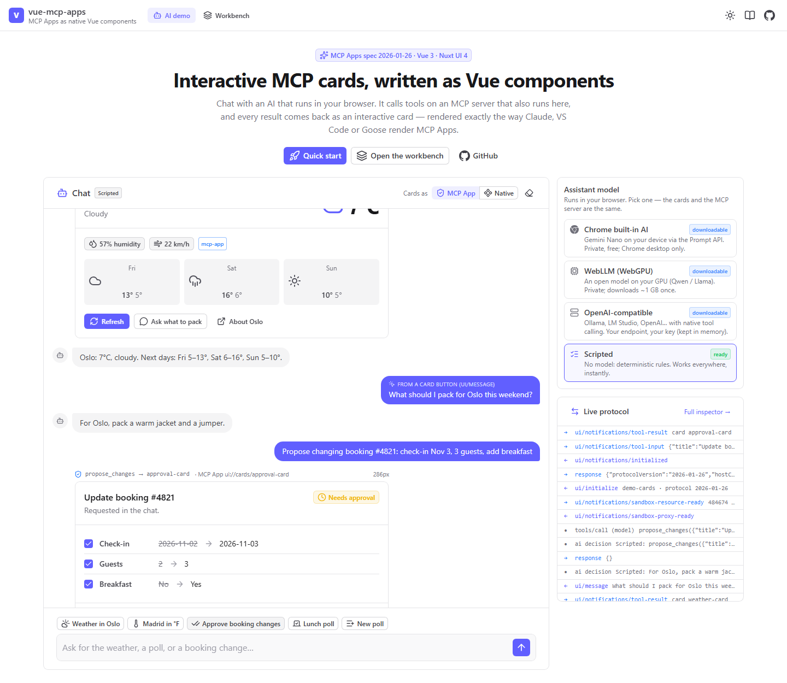
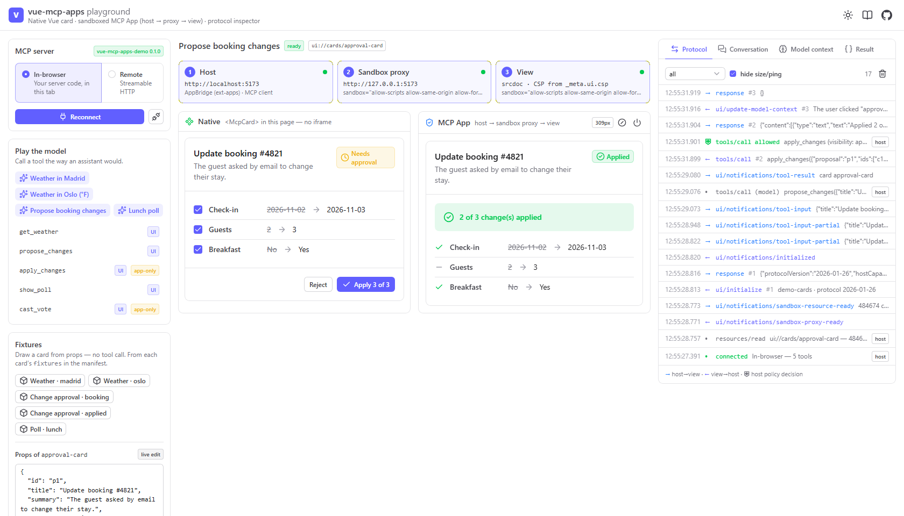

<div align="center">

# vue-mcp-apps

**Write MCP Apps as plain Vue components (Nuxt UI included). Run the same component natively in your own Vue app and sandboxed in Claude, VS Code, Goose or ChatGPT. Test it in a three-layer playground — with an AI that runs in your browser.**

[](https://github.com/JuanmanDev/vue-mcp-apps/actions/workflows/ci.yml)
[](https://github.com/JuanmanDev/vue-mcp-apps/actions/workflows/e2e.yml)
[](https://juanmandev.github.io/vue-mcp-apps/)
[](LICENSE)
[](package.json)
[](https://github.com/modelcontextprotocol/ext-apps/blob/main/specification/2026-01-26/apps.mdx)
[](https://vuejs.org)
[](https://ui.nuxt.com)
[](llms.txt)

**[▶ Live demo](https://juanmandev.github.io/vue-mcp-apps/)** · [Workbench](https://juanmandev.github.io/vue-mcp-apps/#/workbench) · [Integration guide](docs/INTEGRATION.md) · [Architecture](docs/ARCHITECTURE.md) · [Writing cards](docs/WRITING_CARDS.md) · [AI demo](docs/AI_DEMO.md) · [Claude skill](skills/vue-mcp-apps/SKILL.md)

<picture>
  <source media="(prefers-color-scheme: dark)" srcset="docs/media/demo-dark.png">
  
</picture>

</div>

---

## What you will see in the live demo

The demo is a static GitHub Pages site. There is **no backend**: the example MCP server runs inside your browser tab.

- **An AI chat, in your browser.** Type *"What's the weather in Oslo?"*. An assistant picks a tool of the demo MCP server, the page calls it, and the answer arrives as an **interactive card inside the chat**, drawn as a real sandboxed MCP App (host → sandbox proxy → view, driven by the official `AppBridge`).
- **Four ways to run the assistant**, picked for you:
  - **Chrome built-in AI** (Gemini Nano, on-device) when your Chrome has it;
  - **WebLLM**: a small open model (Qwen 2.5, Llama 3.2) downloaded once and run on your GPU through WebGPU;
  - **any OpenAI-compatible endpoint** (Ollama, LM Studio, OpenAI);
  - **Scripted**: no model, deterministic rules, so the demo always works. It is labelled as such.
- **Cards talk back.** Click *Ask what to pack* on the weather card: the card posts a message (`ui/message`) and the assistant answers it. Approve changes on the approval card: the button runs a tool **the model cannot see** (`visibility: ['app']`) — a human must click.
- **The workbench** (`#/workbench`) shows the same card twice — natively and sandboxed — next to a live log of every JSON-RPC message, with controls for theme, locale, host styles, display mode, sandbox strictness, streaming input, cancel and teardown.

---

## Table of contents

- [Why](#why)
- [Concepts in one minute](#concepts-in-one-minute)
- [How it works](#how-it-works)
- [Packages](#packages)
- [Install](#install)
- [Quick start (5 steps)](#quick-start-5-steps)
- [Recipes](#recipes)
- [Integrate with your project](#integrate-with-your-project)
- [The AI demo](#the-ai-demo)
- [The playground / workbench](#the-playground--workbench)
- [Testing your cards](#testing-your-cards)
- [CI/CD](#cicd)
- [AI-assistant friendly](#ai-assistant-friendly)
- [How it compares](#how-it-compares)
- [FAQ](#faq)
- [Troubleshooting](#troubleshooting)
- [Scripts](#scripts)
- [Repository map](#repository-map)
- [Roadmap](#roadmap) · [Contributing](#contributing) · [Credits](#credits) · [License](#license)

---

## Why

[MCP Apps](https://github.com/modelcontextprotocol/ext-apps) (the `io.modelcontextprotocol/ui` extension of the Model Context Protocol) let an MCP tool return an **interactive UI**. The host (Claude, VS Code, Goose, ChatGPT…) draws it in a sandboxed iframe and relays clicks back to your server. The official SDK gives you the protocol. This repo gives you a way to **write, ship and test** that UI with Vue.

- **Cards are plain Vue SFCs.** Props go in, events come out. Use Nuxt UI, Tailwind or any Vue library. A card imports nothing from MCP.
- **One component, two hosts.**
  - **Native** — `<McpCard>` mounts the card straight into your own Vue or Nuxt app (your chat, your dashboard). No iframe, no protocol, your plugins and styles.
  - **MCP App** — the same component, built into one self-contained template that fetches nothing, runs in any MCP Apps host.
- **What a button does is data, not code.** A manifest says the event `approved` runs the tool `apply_changes` — and nothing else. Even if an attacker controls a card's props, the card cannot ask for another tool. A tool only a card may call is marked `visibility: ['app']`, so the model cannot skip the human.
- **Tested against the official host.** Unit tests play our view bridge against ext-apps' `AppBridge`, and our server kit against the real MCP SDK v2 server and client. The playground drives your view with the same `AppBridge` across three real layers (host → sandbox proxy on another origin → view), logging every message.
- **No backend needed to try it.** The real example server runs in the browser over an in-memory transport.

## Concepts in one minute

| Term | Meaning |
| --- | --- |
| **Card** | A Vue component that draws a tool result. Props in, events out. |
| **Manifest** | `defineCards({...})`: every card's title, its **actions** (event → what it may do), optional props schema, fixtures and CSP. Frozen at startup. |
| **Action** | What one card event asks for: `tool` (call a declared tool), `link` (open an http(s) URL), `notify` (show a line), `message` (post a user message to the chat), `context` (tell the model something for its next turn). |
| **Template** | The `ui://cards/<name>` resource (mime `text/html;profile=mcp-app`) a server publishes: one HTML file with Vue, your cards and the CSS inlined. |
| **Host** | The app that shows the conversation and frames the template: Claude, VS Code, the playground. |
| **Sandbox proxy** | A page on **another origin** that the host frames; it frames the view and relays messages. Keeps the view away from the host's cookies and DOM. |
| **View** | The template running in the innermost iframe: `startMcpApp` speaking JSON-RPC over `postMessage`. |
| **`structuredContent.card`** | Where a tool result carries `{ name, props }` for the view. `content` (text) is what the model reads. |
| **Visibility** | `_meta.ui.visibility` on a tool: `['model', 'app']` (default), `['model']`, or `['app']` (only a card's button may call it). |

More in [docs/GLOSSARY.md](docs/GLOSSARY.md).

## How it works

```
                        ┌──────────────────────── MCP server (Node, edge, or in the browser) ─────────────────┐
                        │  createCardServerKit({ manifest, bundle })                                          │
                        │   • registerResources → ui://cards/<name>   (text/html;profile=mcp-app, inlined)    │
                        │   • registerTool(..., { card }) → _meta.ui.resourceUri (+ visibility)               │
                        │   • result(name, props, text) → { content: text, structuredContent: { card } }      │
                        └────────────────────────────────────────┬────────────────────────────────────────────┘
                                                                 │ tools/list · resources/read · tools/call
            MCP Apps host (Claude, VS Code, playground…)          ▼                       Your own Vue app
 ┌─────────────────────────────────────────────────────────────────────────────┐   ┌──────────────────────────────┐
 │ 1 Host page ── AppBridge ──postMessage──┐                                   │   │ <McpCard :result="result"    │
 │                                         ▼                                   │   │   :manifest :components      │
 │ 2 Sandbox proxy (other origin) ── relays ──┐                                │   │   :call-tool />              │
 │                                            ▼                                │   │   └─ CardRenderer            │
 │ 3 View (srcdoc, CSP from _meta.ui.csp)                                      │   │       └─ WeatherCard.vue     │
 │      startMcpApp → McpAppBridge → CardRenderer → WeatherCard.vue            │   │  (same component, no iframe) │
 └─────────────────────────────────────────────────────────────────────────────┘   └──────────────────────────────┘
```

1. The tool's **definition** names a `ui://` template (`_meta.ui.resourceUri`).
2. The host reads the template (one HTML file: your cards, Vue and the CSS, all inlined) and frames it.
3. The host sends the tool's arguments (`ui/notifications/tool-input`, optionally streamed as `tool-input-partial`) and then its **result** (`ui/notifications/tool-result`):
   - `structuredContent.card = { name, props }` is what the view draws;
   - `content` is what the model reads.
4. A click becomes `tools/call`, `ui/open-link`, `ui/message` or `ui/update-model-context`, whichever the manifest declares for that event. The host proxies tool calls to your server, applying the same checks as for the model's calls. A result that carries another card swaps it in.

Deep dive: [docs/ARCHITECTURE.md](docs/ARCHITECTURE.md).

## Packages

| Package | What it does | Runs in |
| --- | --- | --- |
| [`@vue-mcp-apps/core`](packages/core) | The card contract: `defineCards`, `cardActionFor`, `resultCard`, `toPlain`, `safeLinkUrl`, `cardUri`, protocol constants (`METHODS`, `MCP_APP_MIME`, `MCP_APPS_EXTENSION`) and wire types. No DOM, no dependencies. | everywhere |
| [`@vue-mcp-apps/view`](packages/view) | `startMcpApp` (the runtime inside the host's iframe), `<McpCard>` (native mounting), `CardRenderer`, `useCardHost()`, the spec bridge `McpAppBridge`, theming (`applyHostContext`, `NUXT_UI_TOKENS`). Re-exports `core`. | browser |
| [`@vue-mcp-apps/server`](packages/server) | `createCardServerKit`: registers templates, points tools at them, shapes results. Plus `cardTemplateHtml`, `cardToolMeta`, `cardResult`, `asCardBundle`. Works with MCP SDK v2 and v1. | Node, edge, browser |
| [`@vue-mcp-apps/vite`](packages/vite) | `defineCardBundleConfig` / `mcpCardBundle`: builds every card into **one** `cards.json` (one IIFE script + one stylesheet + a source hash). `sourceHash` for freshness tests. | build |

Also in the repo:

- [`examples/demo-cards`](examples/demo-cards): three Nuxt UI cards (weather, change approval, poll) and an MCP server that runs on stdio, over HTTP, or in the browser.
- [`playground`](playground): the demo page (AI chat) and the three-layer workbench.
- [`skills/vue-mcp-apps`](skills/vue-mcp-apps): a Claude Code skill (also installable as a plugin).

## Install

> The packages are not on npm yet. Until they are, use one of the first three options. The import paths are identical in all cases.

**A. Inside this monorepo** — fork or clone it and add your cards next to `examples/demo-cards`. Workspaces link everything; `npm run dev` gives you the playground immediately.

**B. Local path / git submodule** — keep `vue-mcp-apps` next to your project and depend on the built packages:

```bash
git clone https://github.com/JuanmanDev/vue-mcp-apps ../vue-mcp-apps
cd ../vue-mcp-apps && npm ci && npm run build:packages && cd -
npm i ../vue-mcp-apps/packages/core ../vue-mcp-apps/packages/view ../vue-mcp-apps/packages/server
npm i -D ../vue-mcp-apps/packages/vite
```

**C. Tarballs** — build once, vendor the `.tgz` files:

```bash
cd vue-mcp-apps && npm ci && npm run build:packages
for p in core view server vite; do (cd packages/$p && npm pack --pack-destination ../../vendor); done
# in your project (install core together with the others — they depend on it)
npm i ./vendor/vue-mcp-apps-core-0.1.0.tgz ./vendor/vue-mcp-apps-view-0.1.0.tgz ./vendor/vue-mcp-apps-server-0.1.0.tgz
npm i -D ./vendor/vue-mcp-apps-vite-0.1.0.tgz
```

**D. npm (after the first release)**

```bash
npm i @vue-mcp-apps/core @vue-mcp-apps/view @vue-mcp-apps/server
npm i -D @vue-mcp-apps/vite
```

Peer and companion dependencies you will usually want:

```bash
npm i vue @nuxt/ui tailwindcss zod @modelcontextprotocol/server   # SDK v2 (or @modelcontextprotocol/sdk for v1)
npm i -D vite @vitejs/plugin-vue @iconify-json/lucide              # + any icon collections your cards use
```

Full walkthroughs (Nuxt, plain Vue, SDK v1/v2, HTTP, edge): [docs/INTEGRATION.md](docs/INTEGRATION.md).

## Quick start (5 steps)

These are the five files of `examples/demo-cards`, shortened.

**1. Declare the cards** — the manifest is pure data that every side imports.

```ts
// src/manifest.ts
import { defineCards } from '@vue-mcp-apps/core'

export const cards = defineCards({
  'weather-card': {
    title: 'Weather',
    actions: {
      refresh: { kind: 'tool', tool: 'get_weather' }, // runs get_weather, whatever the card sends
      opened:  { kind: 'link' },                       // http(s) only
      asked:   { kind: 'message' },                    // posts a user message to the chat
    },
    fixtures: { madrid: { city: 'Madrid', current: { temp: 24, condition: 'sunny' } } },
  },
})
```

**2. Write the card** — a normal SFC. Props in, events out; the first argument of an event is its payload.

```vue
<!-- src/cards/WeatherCard.vue -->
<script setup lang="ts">
import { useCardHost } from '@vue-mcp-apps/view' // optional: mode, busy, hostContext, toolInput, streaming
defineProps<{ city: string; current: { temp: number; condition: string } }>()
const emit = defineEmits<{ refresh: [args: { city: string }]; asked: [text: string] }>()
const host = useCardHost()
</script>

<template>
  <UCard>
    <p class="text-lg font-semibold">{{ city }} · {{ current.temp }}°</p>
    <UButton icon="i-lucide-refresh-cw" :loading="host.busy.value" @click="emit('refresh', { city })">Refresh</UButton>
    <UButton variant="ghost" @click="emit('asked', `What should I pack for ${city}?`)">Ask</UButton>
  </UCard>
</template>
```

**3. The view entry** — what runs inside the host's iframe.

```ts
// src/view.ts
import './cards.css' // @import "tailwindcss"; @import "@nuxt/ui"; @source "./cards";
import ui from '@nuxt/ui/vue-plugin'
import { startMcpApp } from '@vue-mcp-apps/view'
import { cards } from './manifest'
import WeatherCard from './cards/WeatherCard.vue'

startMcpApp({ manifest: cards, components: { 'weather-card': WeatherCard }, install: app => app.use(ui) })
```

**4. Build one self-contained bundle.**

```ts
// vite.cards.config.ts   →   vite build -c vite.cards.config.ts   →   dist/cards.json
import { defineConfig } from 'vite'
import vue from '@vitejs/plugin-vue'
import ui from '@nuxt/ui/vite'
import { defineCardBundleConfig } from '@vue-mcp-apps/vite'
import { cards } from './src/manifest'

export default defineConfig(defineCardBundleConfig({
  entry: 'src/view.ts',
  outFile: 'dist/cards.json',
  cards: Object.keys(cards),
  plugins: [vue(), ui({ router: false, colorMode: false, icon: { clientBundle: { scan: true } } })],
}))
```

**5. Serve the cards from your MCP server.**

```ts
import { readFileSync } from 'node:fs'
import { McpServer } from '@modelcontextprotocol/server'
import { createCardServerKit } from '@vue-mcp-apps/server'
import { z } from 'zod'
import { cards } from './manifest'

const server = new McpServer({ name: 'weather', version: '1.0.0' })
const kit = createCardServerKit({ manifest: cards, bundle: JSON.parse(readFileSync('dist/cards.json', 'utf8')) })
kit.registerResources(server) // one ui://cards/<name> per card

kit.registerTool(server, 'get_weather', {
  card: 'weather-card',
  description: 'Weather for a city, as an interactive card.',
  inputSchema: z.object({ city: z.string() }),
}, async ({ city }: { city: string }) => kit.result('weather-card', await lookUp(city), `${city}: 21 °C, sunny.`))
```

Then connect a host: `npx @modelcontextprotocol/inspector node server.js` (Apps tab), Claude Desktop, VS Code, or the playground's *Remote* mode. If `cards.json` is missing, the kit registers the tools **without** templates and results still carry their text — the spec's fallback for hosts without UI.

## Recipes

Each recipe lists the files to touch. Longer versions live in [docs/WRITING_CARDS.md](docs/WRITING_CARDS.md).

### Add a card

1. `manifest.ts`: add `'my-card': { title, actions, fixtures }` (kebab-case, at least one dash).
2. `cards/MyCard.vue`: `defineProps` + `defineEmits` with exactly the manifest's event names.
3. `components.ts`: `'my-card': MyCard`.
4. Server: `kit.registerTool(server, 'show_my', { card: 'my-card', … }, … => kit.result('my-card', props, text))`.
5. `npm run build:cards` (or `npm run dev`, which watches), then check it in the workbench.

### Each action kind

```ts
actions: {
  saved:     { kind: 'tool', tool: 'save_item' },          // emit('saved', { id: 1 })            → tools/call save_item {id:1}
  opened:    { kind: 'link' },                              // emit('opened', 'https://…')        → ui/open-link (http/https only)
  cancelled: { kind: 'notify', fallback: 'Cancelled.' },    // emit('cancelled', 'Nothing done')  → line under the card / toast
  asked:     { kind: 'message' },                           // emit('asked', 'Summarise this')    → ui/message (model answers)
  noted:     { kind: 'context' },                           // emit('noted', 'User chose B')      → ui/update-model-context
}
```

### A tool only the card may call (human in the loop)

```ts
// The model proposes…
kit.registerTool(server, 'propose_changes', { card: 'approval-card', inputSchema, description }, propose)
// …only a click applies. The host refuses it from the model and allows it from the card.
kit.registerTool(server, 'apply_changes', { card: 'approval-card', visibility: ['app'], inputSchema }, apply)
```

The card emits `approved` with `{ proposal, ids }`; the manifest maps `approved → apply_changes`. See `examples/demo-cards/src/cards/ApprovalCard.vue`.

### Follow-up card swap

Return another card from the tool a button runs: `return kit.result('poll-card', { ...poll, voted })`. Both hosts swap it in place (`startMcpApp` and `<McpCard :call-tool>`). A result without a card shows its text under the card instead.

### Theme, locale and display mode

```ts
const host = useCardHost()
host.hostContext.value.theme        // 'light' | 'dark' — also toggles the `.dark` class on <html> in the iframe
host.hostContext.value.locale       // 'es-ES' → format numbers/dates, pick strings
host.hostContext.value.displayMode  // 'inline' | 'fullscreen' | 'pip'
host.mode                           // 'native' | 'mcp-app'
```

Host style variables (`hostContext.styles.variables`, e.g. `--color-background-primary`) are applied to `:root` and mirrored onto Nuxt UI tokens through `NUXT_UI_TOKENS`, so a Nuxt UI card matches the host. Pass `tokens: {}` to `startMcpApp` to opt out, or your own map.

### Streaming arguments

`host.toolInput.value` holds the arguments; `host.streaming.value` is `true` while they arrive as `tool-input-partial`. Draw a skeleton from partial input; the card itself is mounted when the result arrives.

### A card that must fetch

Templates fetch nothing by default (the host's CSP). Declare origins per card:

```ts
'map-card': { title: 'Map', resource: { csp: { connectDomains: ['https://api.example.com'], resourceDomains: ['https://tiles.example.com'] } } }
```

### Busy states and errors

`host.busy.value` is `true` while one of the card's tool actions runs. Failures are shown under the card by the shell ("Did not work: …") and, if the host supports it, reported to the model via `ui/update-model-context` (`reportClicksToModel`, default true).

## Integrate with your project

Short versions below; complete, copy-pasteable files are in **[docs/INTEGRATION.md](docs/INTEGRATION.md)**.

### Nuxt 4 app (native cards in your own chat)

```ts
// nuxt.config.ts
export default defineNuxtConfig({
  modules: ['@nuxt/ui'],
  css: ['~/assets/css/main.css'],
  build: { transpile: ['my-cards'] }, // so Nuxt's auto-import transform reaches the cards' <UCard>, <UButton>
})
```

```vue
<!-- components/ToolCard.client.vue -->
<script setup lang="ts">
import { McpCard, type CallToolResult, type CardAction } from '@vue-mcp-apps/view'
import { cards } from 'my-cards/manifest'
import { components } from 'my-cards/components'
const props = defineProps<{ result: CallToolResult }>()
const { callTool } = useMcpClient() // your MCP client composable
function onAction(a: CardAction) { if (a.kind === 'message') sendChatMessage(a.text) }
</script>
<template>
  <McpCard :manifest="cards" :components="components" :result="props.result" :call-tool="callTool" @action="onAction" />
</template>
```

### Plain Vue + Vite app

Register Nuxt UI as a Vue plugin (`app.use(ui)` from `@nuxt/ui/vue-plugin`, `ui()` from `@nuxt/ui/vite` in `vite.config.ts`, with `scanPackages: ['my-cards']` if the cards live in a package) and mount `<McpCard>` exactly as above.

### An existing MCP server — SDK v2

```ts
import { McpServer } from '@modelcontextprotocol/server'
const kit = createCardServerKit({ manifest: cards, bundle })
kit.registerResources(server)
kit.registerTool(server, 'get_weather', { card: 'weather-card', inputSchema: z.object({ city: z.string() }) }, handler)
```

### An existing MCP server — SDK v1 (`@modelcontextprotocol/sdk`)

```ts
import { McpServer } from '@modelcontextprotocol/sdk/server/mcp.js'
const server = new McpServer({ name: 'x', version: '1.0.0' })
kit.registerResources(server)                                     // same call
kit.registerTool(server, 'get_weather', { card: 'weather-card', inputSchema: { city: z.string() } }, handler) // v1 raw shape
```

The kit only needs `registerTool` and `registerResource` (`ServerLike`), so it works with both.

### HTTP: Node, Express, Hono, edge

```ts
import { createMcpHandler } from '@modelcontextprotocol/server'
import { toNodeHandler } from '@modelcontextprotocol/node'
const handler = createMcpHandler(() => createMyServer())           // fresh server per request (stateless)
export default { fetch: (req: Request) => handler.fetch(req) }    // Cloudflare / Bun / Deno / Hono
http.createServer((req, res) => toNodeHandler(handler)(req, res)) // Node http / Express route
```

Keep state outside the factory (a store shared across requests), and allow only known browser origins (CORS allowlist) — see `examples/demo-cards/src/server/http.ts`.

### Your own chat UI

Your chat already has an MCP client. When a tool result carries `structuredContent.card` and you know the card, render `<McpCard>` with `:call-tool` wired to your client; handle `message` actions by sending a chat message and `context` actions by adding to the next prompt. For unknown cards (other servers), frame their `ui://` template with an `AppBridge` and the sandbox proxy (`playground/public/sandbox.html` is dependency-free and copyable) — `playground/src/lib/sandboxHost.ts` is a complete reference host.

### Migrating a hand-rolled card system

This project was extracted from one (Facturador / Hotelier Tools). The mapping:

| Hand-rolled (Facturador) | vue-mcp-apps |
| --- | --- |
| `CARD_ACTIONS` table in `web/lib/card-host.ts` | `defineCards({ name: { actions } })` |
| `mountCard(container, tag, props, onAction)` on custom elements | `<McpCard>` / `CardRenderer` on Vue components |
| `web/lib/mcp-app/bridge.ts` | `McpAppBridge` |
| `web/lib/mcp-app/build-plugin.ts` + `vite.mcp-app.config.ts` | `@vue-mcp-apps/vite` (`defineCardBundleConfig`) |
| `api/mcp-apps.ts` (`registerCardAppResources`, `cardToolMeta`, `adaptCardResult`) | `createCardServerKit` (`registerResources`, `registerTool`, `result`) |
| `structuredContent.card = { tag, props }`, `ui://remote-component/<tag>` | `structuredContent.card = { name, props }`, `ui://cards/<name>` (prefix configurable: `uriPrefix`) |
| `.ce.vue` custom elements with per-component shadow Tailwind | plain `.vue` components; the iframe is the isolation, CSS is one compiled stylesheet |

Step-by-step in [docs/INTEGRATION.md#migrating-a-hand-rolled-card-system](docs/INTEGRATION.md#migrating-a-hand-rolled-card-system).

### Connecting real hosts

| Host | Config |
| --- | --- |
| **Claude Desktop** | `claude_desktop_config.json` → `"mcpServers": { "cards": { "command": "node", "args": ["/abs/path/server.js"] } }` |
| **VS Code ≥ 1.109** | `.vscode/mcp.json` → `"servers": { "cards": { "type": "stdio", "command": "node", "args": ["server.js"] } }` |
| **claude.ai** | Settings → Connectors → *Add custom connector* → your public `https://…/mcp` (a tunnel works for local tests). |
| **MCP Inspector** | `npx @modelcontextprotocol/inspector node server.js` → *Apps* tab. |

## The AI demo

The demo page (`#/`) is a chat whose assistant runs **in your browser** and uses the demo MCP server's tools. Cards appear inline as real sandboxed MCP Apps (or natively — toggle *Cards as: MCP App | Native*).

| Provider | Requirements | Download | Privacy |
| --- | --- | --- | --- |
| **Chrome built-in AI** (Prompt API, Gemini Nano) | Desktop Chrome with built-in AI enabled (`LanguageModel` global) | Model once, managed by Chrome | On-device |
| **WebLLM** (`@mlc-ai/web-llm`) | WebGPU (recent Chrome / Edge, Safari 26+) | Qwen2.5-1.5B-Instruct (~1.6 GB VRAM, default), Llama-3.2-1B-Instruct (~0.9 GB), Qwen2.5-0.5B-Instruct (~0.9 GB) — cached by the browser | On-device |
| **OpenAI-compatible endpoint** | Base URL (+ key) + model: Ollama `http://localhost:11434/v1` (set `OLLAMA_ORIGINS`), LM Studio, OpenAI | none | Whatever the endpoint does; the key stays in this browser session |
| **Scripted** | none | none | Nothing leaves the page — and no model either: deterministic rules |

How a turn works:

1. The assistant sees **only model-visible tools** (`_meta.ui.visibility` includes `"model"`). `apply_changes` and `cast_vote` exist only behind card buttons.
2. Small models answer a JSON decision constrained by a schema — `{"action":"call_tool","tool":"get_weather","arguments":{"city":"Oslo"}}` or `{"action":"answer","text":"…"}`. The OpenAI-compatible provider uses native function calling.
3. The page calls the tool and draws the card in the chat; the assistant then writes one sentence from the tool's text.
4. A card's `ui/message` becomes the next user turn; `ui/update-model-context` is added to the assistant's context.
5. Invalid JSON, an unknown tool or missing arguments fall back to the scripted rules, and the chat says so.

Verified locally with Ollama (`qwen3.5:9b`, OpenAI-compatible provider): asked *"What is the weather like in Lisbon? Use Fahrenheit."*, the model called `get_weather({"city":"Lisbon","unit":"F"})`, the card rendered sandboxed, and the model summarised it. CI runs the same flow against a mocked endpoint (`e2e/demo-chat.spec.ts`).

Try: *"What's the weather in Oslo?"*, *"Weather in Madrid in Fahrenheit"*, *"Propose changing booking #4821: check-in Nov 3, 3 guests, add breakfast"*, *"Show the lunch poll"*, *"Make a poll: tabs or spaces?"*.

Design, exact schema, prompt and how to add a provider: [docs/AI_DEMO.md](docs/AI_DEMO.md).

## The playground / workbench

<picture>
  <source media="(prefers-color-scheme: dark)" srcset="docs/media/playground-dark.png">
  
</picture>

```bash
npm install
npm run dev        # builds the cards, watches them, serves http://localhost:5173  (#/ demo · #/workbench)
```

Open **`http://localhost:5173`** (not `127.0.0.1`): the sandbox proxy is served from `127.0.0.1` so it sits on another origin, like a real host.

| Pane | What you see |
| --- | --- |
| **Native** | The card mounted with `<McpCard>` in the page itself — no iframe. |
| **MCP App** | The same card in three layers: **1** host page (`AppBridge`) → **2** sandbox proxy (other origin, or an opaque sandbox on single-origin deploys like GitHub Pages) → **3** view (`srcdoc`, CSP from `_meta.ui.csp`). |
| **Inspector** | Every JSON-RPC message (→ host→view, ← view→host) and every host policy decision (⛨: card tool calls allowed or refused, and why). Tabs: conversation (`ui/message`), model context, raw result. |

Controls: **play the model** (call any tool, arguments streamed as `tool-input-partial`) · **fixtures** (draw from manifest fixtures, edit props live, re-send to both panes) · **host settings** (theme, locale, host style presets, display mode, proxy origin, view sandbox, auto-approve) · **cancel / teardown** · **hot reload** (saving a card rebuilds `cards.json`, reconnects the in-browser server and replays the run).

**Point it at your own cards:** edit [`playground/src/project.ts`](playground/src/project.ts) — manifest, components, in-browser server factory, bundle, remote URL, example prompts. **Remote mode:** `npm run server:http`, choose *Remote*; the demo server allows only origins in `ALLOWED_ORIGINS`.

Details: [docs/PLAYGROUND.md](docs/PLAYGROUND.md).

## Testing your cards

| Level | Tool | What it proves |
| --- | --- | --- |
| Contract | `vitest` on `cardActionFor`, `defineCards` | A button can only ask for what the manifest says. |
| Protocol conformance | `packages/view/src/bridge.test.ts` | Our view bridge against the **official** `AppBridge`: handshake, input, result, cancel, context, tool calls, links, messages, size, teardown. |
| Server | `packages/server/src/server.test.ts` | Templates, `_meta`, visibility and results against a real SDK v2 `McpServer` + `Client`. |
| Bundle freshness | `examples/demo-cards/test/bundle.test.ts` | `cards.json` matches its sources (`sourceHash`) and fetches nothing. |
| End to end | Playwright in `e2e/` (`npm run test:e2e`) | The three layers in a real browser, card clicks, the scripted AI chat. Also run against the live site after every deploy. |
| Packed packages | `npm run test:packages` (CI on Node 20/22/24) | What `npm i` gives a user: files, exports, Node support. |
| Official tools | `npx @modelcontextprotocol/inspector --cli <server> --method tools/call --tool-name get_weather --tool-arg city=Madrid --app-info` | `{"hasApp":true,"resourceUri":"ui://cards/weather-card",…}` |
| Real hosts | ext-apps `basic-host`, Claude, VS Code, Goose, MCPJam | It works where your users are. |

Reaching inside the view from Playwright:

```ts
const view = page.frameLocator('iframe[title="Sandbox proxy"]').frameLocator('iframe[title="MCP App view"]')
await view.getByRole('button', { name: 'Refresh' }).click()
```

More: [docs/TESTING.md](docs/TESTING.md).

## CI/CD

| Workflow | Trigger | Does |
| --- | --- | --- |
| [`ci.yml`](.github/workflows/ci.yml) | push to `main`, PRs | `npm ci` → build packages → build cards → bundle freshness → unit/protocol tests → typecheck → build playground. |
| [`e2e.yml`](.github/workflows/e2e.yml) | push to `main`, PRs | Playwright (Chromium) against the built playground: three layers, card clicks, scripted AI chat. Uploads the report on failure. |
| [`pages.yml`](.github/workflows/pages.yml) | push to `main`, manual | Builds the playground with `PLAYGROUND_BASE=/<repo>/` and deploys it to GitHub Pages. |
| [`release.yml`](.github/workflows/release.yml) | tag `v*` | Build + test, then `npm publish --provenance --access public` for `packages/*` when the `NPM_TOKEN` secret exists; creates a GitHub release with generated notes. |
| [`codeql.yml`](.github/workflows/codeql.yml) | push, PRs, weekly | CodeQL for JavaScript/TypeScript. |
| [`dependabot.yml`](.github/dependabot.yml) | weekly | npm and GitHub Actions updates. |

Setup: *Settings → Pages → Source: GitHub Actions*; add `NPM_TOKEN` (an npm automation token) to publish. Details: [docs/CI_CD.md](docs/CI_CD.md).

## AI-assistant friendly

- **[`llms.txt`](llms.txt)** — the [llms.txt](https://llmstxt.org) index of the docs; **[`llms-full.txt`](llms-full.txt)** — every doc in one file (`npm run docs:llms` regenerates it).
- **[`AGENTS.md`](AGENTS.md)** — terse guide for coding agents (file map, commands, invariants, recipes).
- **[`CLAUDE.md`](CLAUDE.md)** — the same for Claude Code, pointing at the skill.
- **Claude skill** — teaches the mental model, recipes, invariants and how to debug the three layers:

```bash
# as a plugin, in any project
/plugin marketplace add JuanmanDev/vue-mcp-apps
/plugin install vue-mcp-apps@vue-mcp-apps

# or copy it
npm run skill:install                       # ~/.claude/skills/vue-mcp-apps
npm run skill:install -- --project ../app   # ../app/.claude/skills/vue-mcp-apps
```

Prompt to give any assistant: *"Read https://raw.githubusercontent.com/JuanmanDev/vue-mcp-apps/main/llms-full.txt, then add a card for X to my MCP server."*

## How it compares

| | `@modelcontextprotocol/ext-apps` (raw `App`) | `mcp-ui` (`@mcp-ui/client` 7.x) | **vue-mcp-apps** |
| --- | --- | --- | --- |
| What it is | Official SDK: protocol, `App`, `AppBridge`, server helpers | Host renderer + resource helpers; MCP Apps compliant | Vue-first authoring + native host + bundler + playground |
| View framework | Any (React hooks included; Vue example uses `App` directly) | Any (HTML / remote DOM); host side is React | Vue 3 SFCs, Nuxt UI ready |
| Same component in your app without an iframe | — | — | `<McpCard>` |
| What a click may do | Whatever the view's code calls | Whatever the view posts | Declared per event in a manifest |
| View runtime | `App` brings the MCP SDK and zod | n/a (host library) | Dependency-free bridge |
| MCP SDK | v2 | v1 (`@modelcontextprotocol/sdk`) + zod 3 | Server helpers SDK-agnostic (v1 or v2); playground on v2 |
| Testing | `basic-host`, MCP Inspector | `ui-inspector` | Three-layer playground on the official `AppBridge` + in-browser AI demo + any host above |

They work together: vue-mcp-apps views speak the spec's wire protocol, so any ext-apps or mcp-ui host draws them, and the playground's host side *is* ext-apps' `AppBridge`.

## FAQ

**Do I need Nuxt?** No. Nuxt UI runs as a Vue plugin; any Vue 3 component library works, or none.

**Do cards work in hosts that do not support MCP Apps?** The tool result always carries text in `content`; those hosts show the text.

**Why one bundle for all cards?** Simple and offline-proof: one build, one file, inlined into every template (~470 kB for the demo). Per-card bundles are on the roadmap.

**Can a card call any tool?** No. Only the tool its manifest declares for that event, and the host re-checks visibility.

**Can I use React views with this server kit?** Yes — the server kit only needs a bundle `{ script, css, cards }`; build it however you like.

More in [docs/FAQ.md](docs/FAQ.md).

## Troubleshooting

| Symptom | Cause → fix |
| --- | --- |
| View never sends `ui/notifications/initialized` | The host sent a Vue reactive proxy (`hostContext`, args) → `DataCloneError`. Send plain JSON (`toPlain` / `JSON.parse(JSON.stringify())`). |
| Card button does nothing, console shows `DataCloneError` | The card emitted a `ref`/`reactive`; `cardActionFor` clones it — make sure you use an up-to-date bundle. |
| Icons missing inside the iframe | Iconify tried to fetch; enable `icon: { clientBundle: { scan: true } }` and install `@iconify-json/<collection>`. |
| `cards.json` has `css 0 kB` | The bundle plugin ran before Vite's CSS plugin; use `@vue-mcp-apps/vite` ≥ 0.1.0 (`enforce: 'post'`) and rebuild its `dist`. |
| `Failed to resolve entry for package "pkce-challenge"` | `resolve.conditions` replaced Vite's defaults → `['vue-mcp-apps:source', ...defaultClientConditions]`. |
| `vue-tsc` errors inside `@internationalized/date` | A bare `source` condition; use `vue-mcp-apps:source`. |
| Card not drawn, "Nothing to show." | The result lacks `structuredContent.card`, or the card is not in the bundle (`cards: Object.keys(manifest)`). |
| "Refused by host: tool is not visible to apps" | The tool's `visibility` is `['model']`; add `'app'`. |
| Remote mode: CORS / 403 | Add your origin to the server's allowlist (`ALLOWED_ORIGINS` in the demo). |
| `PLAYGROUND_BASE=/x/` becomes `C:/Program Files/Git/x/` | Git Bash path conversion: prefix with `MSYS_NO_PATHCONV=1`. |

Full table: [docs/TROUBLESHOOTING.md](docs/TROUBLESHOOTING.md).

## Scripts

| Script | What it does |
| --- | --- |
| `npm run dev` | Playground (demo + workbench) with live card rebuilds on `http://localhost:5173`. |
| `npm run build` | Packages → card bundle → static playground. |
| `npm run build:packages` | `tsc -b` for the four packages (to `dist/`). |
| `npm run build:cards` | `examples/demo-cards/dist/cards.json`. |
| `npm run build:playground` | Static playground (`PLAYGROUND_BASE=/vue-mcp-apps/` for GitHub Pages). |
| `npm run server:http` | Demo MCP server on `http://localhost:3001/mcp`. |
| `npm run server:stdio` | Demo MCP server on stdio. |
| `npm test` / `npm run test:watch` | Vitest (contract, protocol conformance, server kit, bundle freshness). |
| `npm run test:e2e` | Playwright end-to-end tests (`E2E_BASE_URL=<url>` runs them against a deployed site). |
| `npm run test:packages` | Pack the four packages, install them into a blank project, smoke-test them as a user would. |
| `npm run typecheck` | `tsc -b` for the packages, `vue-tsc` for the example and the playground. |
| `npm run docs:llms` | Regenerates `llms-full.txt`. |
| `npm run skill:install` | Copies the Claude skill (`-- --project <dir>` for one project). |

## Repository map

```
packages/core        card contract + protocol constants (no deps)
packages/view        startMcpApp · McpCard · CardRenderer · useCardHost · McpAppBridge · theme
packages/server      createCardServerKit · cardTemplateHtml · cardToolMeta · cardResult
packages/vite        defineCardBundleConfig · mcpCardBundle · sourceHash
examples/demo-cards  manifest · 3 Nuxt UI cards · view entry · server (stdio / http / browser)
playground           #/ AI demo · #/workbench · public/sandbox.html (layer 2) · src/lib/sandboxHost.ts (layer 1)
playground/src/ai    chat providers (Chrome AI, WebLLM, OpenAI-compatible, scripted)
e2e                  Playwright tests
skills/vue-mcp-apps  Claude skill (+ references/protocol.md, references/api.md)
docs                 ARCHITECTURE · INTEGRATION · WRITING_CARDS · PLAYGROUND · AI_DEMO · TESTING · CI_CD · FAQ · TROUBLESHOOTING · GLOSSARY
```

## Roadmap

- Publish the packages to npm (release workflow is ready).
- Per-card bundles, so a template carries only what its card uses.
- Custom-element export (`defineCardElement`) for hosts not written in Vue.
- A Nuxt module (auto-register cards, a server route for `/mcp`).
- More demo cards (table, form, chart) and more AI providers.

## Contributing

Issues and PRs welcome — see [CONTRIBUTING.md](CONTRIBUTING.md). Run `npm test`, `npm run typecheck`, `npm run test:packages` and `npm run test:e2e` before opening a PR; rebuild `cards.json` when a card or `packages/view`/`core` changes. Security issues: [SECURITY.md](SECURITY.md).

## Credits

Extracted from the card system of **Facturador / Hotelier Tools**, where the same cards run inside the app's own chat and inside Claude as MCP Apps. Built on the [MCP Apps specification](https://github.com/modelcontextprotocol/ext-apps) and its reference `AppBridge`, [Nuxt UI](https://ui.nuxt.com), [WebLLM](https://github.com/mlc-ai/web-llm) and Chrome's [built-in AI](https://developer.chrome.com/docs/ai/built-in).

## License

[MIT](LICENSE) © 2026 Juan Manuel Bécares
